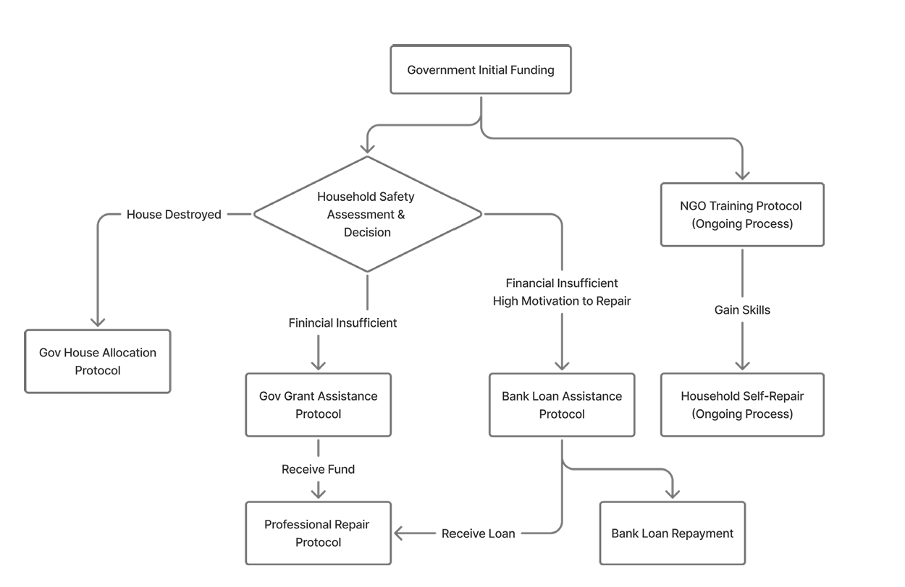

# Post-Earthquake Housing Recovery: A Multi-Agent Simulation

An agent-based model (NetLogo 3D) of how households, government, an NGO, a bank and repair professionals interact to make homes safer after an earthquake. It runs on **1,802 real building footprints from Gorkha Municipality, Nepal**, near the epicentre of the 2015 Gorkha earthquake.

The model is a decision-support tool: policymakers can test how different splits of a fixed government budget (grants to households, NGO safety training, buying homes for people whose houses were destroyed) change how many homes become safe, and how quickly.

---

## Key results

- **Budget split:** a sweep of 121 budget allocations found that the best-performing split gave **73% to household grants, 18% to NGO training and 9% to buying homes**. Every split tested gave 70–80% to grants.
- **Two recovery phases:** safety improves quickly for about **16 months**, then slows down sharply, once there are no more homes for the government to buy for households whose houses were destroyed.
- **Short vs long term:** buying homes raises safety quickly at first; funding training starts slowly but pays off over time.
- **Realism check:** at year 3, the model reaches **65% recovery**, compared with 70–87% in field survey data from the 2015 earthquake (Platt et al., 2020). It reproduces the shape of the real recovery curve but underestimates how slowly disadvantaged groups recover.

## Limitations

- The sweep only covered a narrow range (0–20% to buying homes, 70–80% to grants, 10–20% to NGOs), so it cannot show how splits outside that range compare.
- Repair costs per safety feature are approximations and are the parameter the results are most sensitive to. They were not varied in the analysis.
- Earthquake damage is random per feature and does not model structural dependencies (e.g. a damaged wall affecting the roof).
- Not modelled: material shortages, bureaucratic delays, grant tranche inspections and social networks.
- Runs do not use a fixed random seed, so exact results vary between runs.

## Team

Built for the *Agentic & Multi-Agent Systems* course at the University of Twente (2025) by Andrea Battarelli Martini, Lazar Milic, Jennie Powers, Markel Benedicto Costa and Munan Wang.

---

## How it works

### Agents

| Agent | Role |
|---|---|
| **Households** (residents + homes) | Decide each day whether to self-repair (if trained), hire professionals, apply for a government grant or bank loan, or request a new home |
| **Government** | Funds the NGO, gives grants to the lowest-income households first, and buys the cheapest empty homes for people whose houses were destroyed |
| **NGO** | Trains residents in batches of 20 so they can self-repair |
| **Professionals** | Repair homes from a first-come, first-served queue, with limited crew capacity |
| **Bank** | Lends to households (higher income first) and collects 12 monthly repayments |

Each home has **14 binary seismic-safety features** (`f1`–`f14`), based on Nepal's reconstruction guidelines. Its **safety score** is the number of features in place (0–14), and **8** counts as safe.

### Each simulated day (1 tick = 1 day)

1. **Repair planning:** for each home below 8, find the cheapest set of missing features that would reach 8. Above 8, the resident's motivation decides whether to stop, repair 3 more features, or repair everything.
2. **Monthly cycle (every 30 ticks):** residents earn income; the government refreshes its budget according to the three budget sliders; the NGO receives its share.
3. **Household decisions:**
   - safety ≤ 1 → ask for a government home
   - trained → self-repair
   - income ≥ 2× repair cost → hire professionals
   - otherwise → apply for a government grant
   - safe but motivated to improve further → apply for a bank loan
4. **NGO, government, professionals and bank** each process their queues.
5. **Display:** homes are recoloured (red < 8, yellow 8–13, blue = 14) and plots update.
6. **Milestones:** mean safety and number of safe homes are recorded at 3, 6, 12, 24 and 36 months.

The **Earthquake** button applies a shock that removes random features, with larger losses for homes that are already less safe.

### Default parameters

| Parameter | Default |
|---|---|
| Government starting budget | 80,000 NPR |
| Bank starting funds | 100,000 NPR |
| Loan interest | 5% flat, repaid over 12 months |
| NGO training | batches of 20, 50 days, 23,200 NPR per batch |
| Professionals | 15 crews, 5 days per feature |
| Repair cost per feature | 544–1,485 NPR (see code) |

---

## Running the model

### Requirements

- [NetLogo 3D 7.0](https://ccl.northwestern.edu/netlogo/)
- Extensions: `gis`, `csv`, `nw`, `table`, `view2.5d`

### Steps

1. Clone the repo and open `ABM-Earthquake-Recovery.nlogox3d` in **NetLogo 3D** (not the 2D version).
2. Set the three budget sliders (`buying-homes-multiplier`, `residents-money-multiplier`, `ngos-money-multiplier`) so they **add up to 1.0**. The defaults are 0.05 / 0.78 / 0.17.
3. Click **SET UP** to load the data and create the agents.
4. Click **GO** to run the simulation.
5. Optionally, click **Earthquake - Test Shock** at any time.

To repeat the scenario analysis, use **Tools → BehaviorSpace**, vary the three sliders and record the milestone reporters (`mean-safety-…-after`, `safe-houses-…-after`). For reproducible runs, set a fixed seed with `random-seed` in `setup`.

### Data

| File | Contents | Source |
|---|---|---|
| `data/Community_Buildings.shp` | Building footprints (ID field `OSM_ID`) | Humanitarian OpenStreetMap Team |
| `data/housing_data.csv` | Per-household income, training status, motivation and features `f1`–`f14`, linked by `OSM_ID` | Adapted from the Gorkha household survey (Saputra, 2024) |
| `data/Community_Roads.shp` | Road network (display only) | OSGeo Nepal |
| `data/Community_DEM.asc` | Elevation, shown as 2.5D terrain | Copernicus GLO-30 |
| `data/Community_Slope.asc`, `data/Community_Landuse.asc` | Optional rasters (not used by the rules) | OSGeo Nepal |

Homes without a matching household record are treated as empty, and the government can buy them.

### Troubleshooting

- **"Missing …shp/CSV":** check the file names match the table above, and that each shapefile has its `.dbf`, `.shx` and `.prj` files.
- **No agents appear:** check that `OSM_ID` exists in both the buildings `.dbf` and the CSV, and that some IDs match.
- **`view2.5d` not found:** install the extension in NetLogo's `extensions/` folder.
- **Wrong positions:** keep all GIS layers in the same projected coordinate system.

## License

MIT. See [LICENSE](LICENSE).
